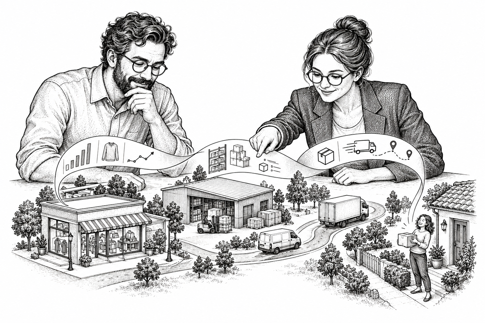

# Lumina Retail
### Anticipar la demanda. Optimizar el inventario. Acelerar la entrega.

[Explorar los diagramas](#guía-de-arquitectura) · [Resumen ejecutivo](#resumen-ejecutivo) · [Informe completo](docs/report/Lumina_Retail_Informe.pdf)

## Resumen ejecutivo

Lumina Retail propone una plataforma de datos en Google Cloud para RetailSmart Global que integra ventas, pedidos, inventario, logística, clientes y telemetría. Busca reducir la fragmentación de información y acelerar las decisiones ante quiebres de stock, cambios de demanda, saturación logística y degradación de activos.

La arquitectura combina procesamiento en tiempo real, por lotes, analítica y capacidades predictivas. Organiza los datos en capas Bronze, Silver y Gold, con controles de calidad, trazabilidad y seguridad, para generar alertas, análisis y recomendaciones que apoyen a los responsables operativos.

La implementación propuesta prioriza un recorrido completo de inventario y pedidos, cuya calidad y utilidad deberán validarse antes de ampliar los casos de uso. El beneficio esperado es mejorar el servicio y la eficiencia operativa; su comprobación requiere registrar las decisiones y medir sus resultados. Los sistemas operacionales conservan la ejecución de reservas, pagos y despachos.

  

## Informe del proyecto

Consulta el [informe completo](docs/report/Lumina_Retail_Informe.pdf), que presenta la arquitectura de datos de Lumina Retail, sus componentes, flujos de integración y decisiones de diseño en Google Cloud.

## Guía de arquitectura

Recorre la arquitectura desde la visión del negocio hasta sus componentes. En cada vista puedes comparar la situación actual (AS-IS) con la propuesta (TO-BE).

| Vista | ¿Qué muestra? | Situación actual | Propuesta |
| --- | --- | --- | --- |
| Contexto del negocio | La relación de la plataforma con el entorno empresarial. | [Ver contexto actual](docs/report-resources/figures/arquitectura/01_contextual_asis.pdf) | [Ver contexto propuesto](docs/report-resources/figures/arquitectura/02_contextual_tobe.pdf) |
| Atención de pedidos | El recorrido del pedido y el apoyo de la inteligencia de datos. | [Ver proceso actual](docs/report-resources/figures/arquitectura/03_pedidos_asis.pdf) | [Ver proceso propuesto](docs/report-resources/figures/arquitectura/04_pedidos_tobe.pdf) |
| Aplicaciones y procesos | Cómo se relacionan los sistemas con las actividades del negocio. | [Ver aplicaciones actuales](docs/report-resources/figures/arquitectura/05_aplicaciones_procesos_asis.pdf) | [Ver aplicaciones propuestas](docs/report-resources/figures/arquitectura/06_aplicaciones_procesos_tobe.pdf) |

Para profundizar en la solución, consulta la [vista general de integración](docs/report-resources/figures/arquitectura/07_integracion_macro_tobe.pdf) y después el [detalle de componentes y flujos](docs/report-resources/figures/arquitectura/08_integracion_detallada_tobe.svg) ([versión PDF](docs/report-resources/figures/arquitectura/08_integracion_detallada_tobe.pdf)).

### Vista detallada de la solución

