# Lumina Retail | Informe de implementación y validación de la plataforma de datos

**Organización:** RetailSmart Global · **Solución:** Lumina Retail · **Documento:** Informe técnico de implementación · **Plataforma:** Google Cloud

## Índice

1. [Resumen ejecutivo](#1-resumen-ejecutivo)
2. [Contexto empresarial y objetivos](#2-contexto-empresarial-y-objetivos)
3. [Arquitectura de solución](#3-arquitectura-de-solucion)
4. [Fuentes, contratos y arquitectura de datos](#4-fuentes-contratos-y-arquitectura-de-datos)
5. [Implementación de pipelines streaming](#5-implementacion-de-pipelines-streaming)
6. [Implementación de pipelines batch](#6-implementacion-de-pipelines-batch)
7. [Transformación, calidad e integración](#7-transformacion-calidad-e-integracion)
8. [Modelado analítico y productos Gold](#8-modelado-analitico-y-productos-gold)
9. [Exposición y consumo de datos](#9-exposicion-y-consumo-de-datos)
10. [Seguridad, gobierno y observabilidad](#10-seguridad-gobierno-y-observabilidad)
11. [Validación end-to-end y resultados](#11-validacion-endtoend-y-resultados)
12. [Conclusiones y hoja de evolución](#12-conclusiones-y-hoja-de-evolucion)

**Anexos:** [A. Interfaces y recursos](#anexo-a-inventario-de-interfaces-y-recursos) · [B. Eventos y mensajería](#anexo-b-contratos-de-eventos-y-mensajeria) · [C. API REST](#anexo-c-contratos-rest-de-consumo) · [D. Diccionario físico](#anexo-d-diccionario-fisico-de-datos) · [E. Batch](#anexo-e-contratos-de-archivos-y-procesamiento-batch) · [F. Transformaciones](#anexo-f-mapeo-de-transformaciones-y-reglas-de-calidad) · [G. Productos Gold](#anexo-g-contratos-de-productos-analiticos-gold) · [H. Metadatos y linaje](#anexo-h-metadatos-linaje-y-controles-operativos) · [I. Pruebas](#anexo-i-pruebas-de-contrato-e-integracion) · [J. Referencias](#anexo-j-referencias-tecnicas-y-fuentes-de-verdad).


---

## 1. Resumen ejecutivo


### Visión ejecutiva y alcance

RetailSmart Global necesita transformar señales fragmentadas de pedidos, inventario, logística y telemetría en información trazable para decisiones operativas. Lumina Retail implementa una plataforma analítica desacoplada de los sistemas transaccionales. La solución integra **pipelines de transformación, procesamiento híbrido por lotes y en tiempo real y productos analíticos**, con trazabilidad entre fuentes, procesamiento y consumo.

| Compromiso | Materialización técnica | Criterio de aceptación |
|---|---|---|
| Procesamiento continuo | Pub/Sub → Apache Beam/Dataflow → BigQuery Silver/Gold | Correlación del mismo `event_id` entre entrada, curación y salida |
| Procesamiento por lotes | Landing → BigQuery Bronze/Silver/Gold, orquestado con Workflows | `batch_id` y conteos conciliados en cada etapa |
| Integración de datos | Normalización, reglas de calidad y joins por claves sustentadas | Evidencia SQL y resultado antes/después |
| Analítica | Productos Gold, Operational Mart, vistas | Esquemas, granularidad y consultas reproducibles |

**Límites de la solución:** los sistemas productores empresariales y las aplicaciones consumidoras externas permanecen desacoplados de la plataforma. La predicción de demanda se incorpora como una capacidad analítica de referencia. Los beneficios operativos se evalúan contra una línea base y resultados reproducibles.

**Criterio de aceptación:** trazabilidad verificable entre los eventos o archivos de origen, las transformaciones aplicadas y los productos de datos publicados. Los resultados de ejecución se consignan en el capítulo 11.


---

## 2. Contexto empresarial y objetivos


### Situación empresarial

La arquitectura responde a cinco problemas documentados: riesgo de quiebre de stock, desalineación geográfica del inventario, saturación operativa, comportamiento fragmentado del cliente y riesgo de fallas de activos. La plataforma habilita cuatro verticales de análisis y recomendación, sin convertirse en sistema transaccional de registro.

| Necesidad | Señal o producto de datos | Dependencia |
|---|---|---|
| Anticipar quiebre | CU01 riesgo de quiebre | pedidos, inventario, SKU, tienda |
| Planificar reposición | CU02 plan de reposición | histórico, stock, predicción |
| Evaluar operación | CU03 KPIs operativos | pedidos, entregas, periodos |
| Priorizar mantenimiento | CU04 alertas de mantenimiento | telemetría y activos |

### Alcance de la implementación

La implementación se organiza en tres capacidades principales: limpieza, enriquecimiento e integración de fuentes; procesamiento híbrido de eventos y lotes; y consolidación de estructuras analíticas. Gobierno, exposición mediante API y predicción complementan estas capacidades.

**Hipótesis de valor:** integrar datos con trazabilidad permite decisiones más oportunas. **Validación requerida:** medir tiempo de disponibilidad del dato, completitud, duplicados y conciliación por escenario. Los indicadores de servicio se evalúan con mediciones de ejecución y una línea base explícita.


---

## 3. Arquitectura de solución


### Arquitectura de referencia y arquitectura implementada


La vista ArchiMate describe los componentes, integraciones y responsabilidades de la solución. El inventario de servicios y sus configuraciones se presenta en el anexo A.

| Componente | Diseño de referencia | Implementación de Lumina Retail | Consideraciones operativas |
|---|---|---|---|
| Bronze y Silver | Almacenamiento de objetos / Parquet | BigQuery | SQL unificado y acceso analítico; controlar costos de almacenamiento y consultas |
| Landing | Cloud Storage | Cloud Storage | Conservación de archivos de entrada y URI de origen |
| Mensajería | Pub/Sub | Pub/Sub | Suscripciones independientes para raw y procesamiento |
| Streaming | Beam/Dataflow | Beam/Dataflow | Separación de transporte, validación y escritura |
| Batch | Procesamiento por lotes | Workflows + SQL / cómputo opcional | Orquestación explícita; Dataproc efímero si corresponde |
| Exposición | Productos analíticos | BigQuery Gold + Cloud Run privado | Lectura IAM y API sin consumidor externo aprovisionado |

**Control operativo:** la ejecución de los servicios se complementa con conciliaciones de registros y comprobación de los datos materializados. El estado de infraestructura y la integridad del dato se supervisan por separado.

**Figura EV-ARC-01 — Inventario de servicios GCP**

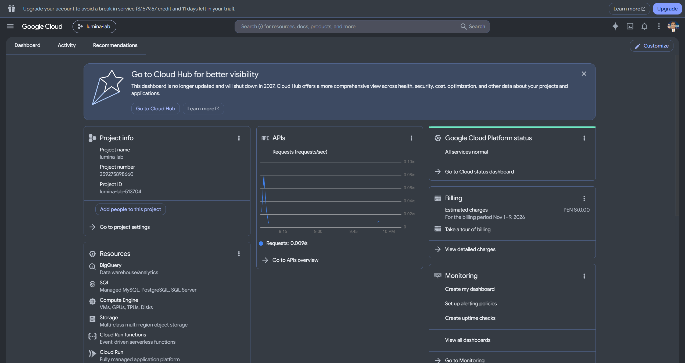

*Figura de referencia operativa. Vista prevista: proyecto, región, recursos reales y estado. Archivo de evidencia: `01-fundacion/01-inventario-servicios.png`.*


---

## 4. Fuentes, contratos y arquitectura de datos

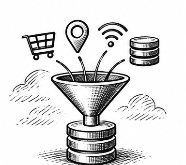

### Fuentes propias y contratos de generación

La implementación utiliza **exclusivamente conjuntos de datos y eventos ad hoc generados para Lumina Retail**. No se han ingerido datasets públicos ni conectado fuentes externas reales. Las familias descritas representan escenarios de negocio simulados y se procesan mediante los contratos y pipelines propios de la plataforma.


| Familia | Fuente de datos | Aplicación en la solución | Precaución |
|---|---|---|---|
| Datos operativos ad hoc | pedidos, inventario y entregas generados para Lumina Retail | cargas batch y modelado analítico | Conservar identificadores, granularidad y versión de generación |
| Datos contextuales ad hoc | benchmark de competidores, eventos locales y redes sociales generados para escenarios controlados | enriquecimiento batch | Identificar cada conjunto como dato sintético, no como extracción externa |
| Eventos operativos ad hoc | pedidos, inventario, sensores y telemetría producidos por generadores propios | procesamiento streaming | Correlacionar evento, escenario y ejecución |

### Contrato lógico de evento

El generador publica un mensaje JSON con el siguiente contrato de referencia, definido en `docs/arquitectura/contrato-evento-original.json`:

| Campo de entrada | Tipo | Propósito | Ejemplo del contrato |
|---|---|---|---|
| `schema_version` | string | versión del esquema | `1.0.0` |
| `simulation_id` / `scenario_id` | string | correlación de simulación y escenario | `sim-20261103-001` / `black-friday` |
| `producer_id` / `event_type` | string | productor y tipo de evento | `channel-apps` / `order_created` |
| `event_id` / `trace_id` | string | identidad y seguimiento | `evt-000001` / `trace-order-000001` |
| `occurred_at` / `emitted_at` | string ISO 8601 | tiempos de negocio y emisión | `2026-11-03T10:00:00Z` |
| `payload` | objeto JSON | atributos del pedido | `order_id, customer_id, store_id, product_id, quantity` |

**Salida contractual:** Pub/Sub distribuye el mensaje a los destinos de persistencia raw y procesamiento. El contrato original utiliza `payload.product_id`; el modelo batch Silver utiliza `sku_id`. Esta correspondencia requiere transformación explícita y no se presupone. El contrato íntegro y sus tipos se documentan en el anexo B.

### Medallion físico

| Capa | Servicio | Responsabilidad |
|---|---|---|
| Landing | Cloud Storage | archivos batch, URI y staging |
| Bronze | BigQuery | raw Pub/Sub, JSON, metadata y lotes |
| Silver | BigQuery | entidades tipadas, normalizadas, con calidad |
| Gold | BigQuery | CU01–CU04, predicciones, Mart y vistas |

### Contrato de metadatos por modalidad

| Modalidad | Identificador de entrada | Metadatos conservados | Destino |
|---|---|---|---|
| Streaming | `event_id`, `trace_id` | `message_id`, `publish_time`, `subscription_name`, `attributes` | BigQuery Bronze raw |
| Batch | `batch_id`, `file_id`, `source_row_number` | `source_file_uri`, `source_system`, `ingested_at`, `record_hash`, `is_valid`, `error_reason` | BigQuery Bronze `*_raw` |
| Curación | clave de negocio del dominio | campos tipados y `quality_status` | BigQuery Silver |

El diccionario físico completo se mantiene en el anexo D.

**Figura EV-DAT-01 — Buckets de Landing y artefactos**

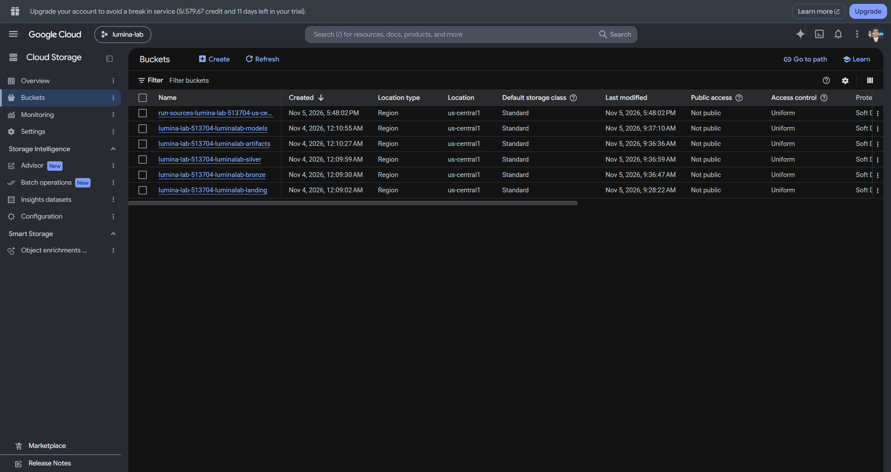

*Figura de referencia operativa. Vista prevista: ubicación, nombres y políticas de acceso sin exponer secretos. Archivo de evidencia: `01-fundacion/02-storage-buckets.png`.*

**Figura EV-DAT-02 — Datasets Bronze, Silver y Gold**

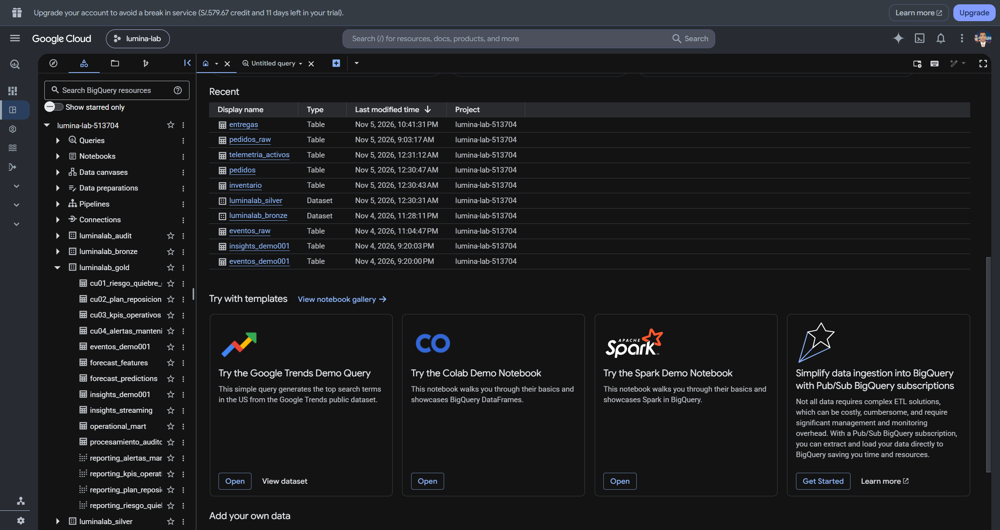

*Figura de referencia operativa. Vista prevista: datasets reales, tablas y región. Archivo de evidencia: `01-fundacion/03-bigquery-medallion.png`.*


---

## 5. Implementación de pipelines streaming

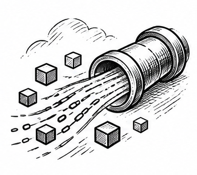

### Bifurcación del tópico de entrada

La publicación se entrega a tres suscripciones independientes: una exporta el raw hacia BigQuery Bronze, otra conserva archivos JSONL en Cloud Storage y otra alimenta el procesamiento Apache Beam/Dataflow hacia Silver. El consumidor debe preservar `event_id`, `message_id`, `publish_time` y los atributos pertinentes. La transformación de `order_created` produce la entidad Silver de pedidos cuando satisface las reglas.

| Etapa | Entrada | Operación | Salida / control |
|---|---|---|---|
| Publicación | JSON de evento | Validación contractual de origen | `event_id` y `messageId` |
| Raw | Suscripción BigQuery | Persistencia del mensaje | `Bronze.eventos_raw_pubsub` |
| Curación | Suscripción Dataflow | Parseo, validación, tipado, filtro | `Silver.pedidos` |
| Negocio | Silver | Reglas y materialización | Productos Gold pertinentes |
| Cierre | Dataflow job | Cancelación explícita | `job_id`, estado terminal |

**Prueba funcional mínima:** publicar un evento único; consultar Bronze y Silver filtrando por el mismo `event_id`; verificar `order_id`, calidad y campos normalizados; conservar el ID del job y su cierre. Los duplicados y eventos tardíos requieren criterios explícitos de idempotencia y vigencia.

### Contrato de salida de Insights y auditoría

| Producto Gold | Entrada | Campos de salida | Clave de correlación |
|---|---|---|---|
| `insights_streaming` | eventos del pipeline de Insights | `insight_id`, `event_id`, `insight_type`, `sku_id`, `store_id`, `score`, `created_at`, `status` | `event_id` |
| `procesamiento_auditoria` | procesamiento de eventos | `audit_id`, `event_id`, `component`, `status`, `observed_at`, `detail` | `event_id` |

El segundo tópico y su Dataflow producen `Gold.insights_streaming` y `Gold.procesamiento_auditoria`. Se exige la misma correlación en ambas. Si no se observa `EVENTO_RECIBIDO` o `INSIGHT_GENERADO`, registrar el caso como no verificado, aunque el job esté RUNNING.

**Figura EV-STR-01 — Tópico y suscripciones**

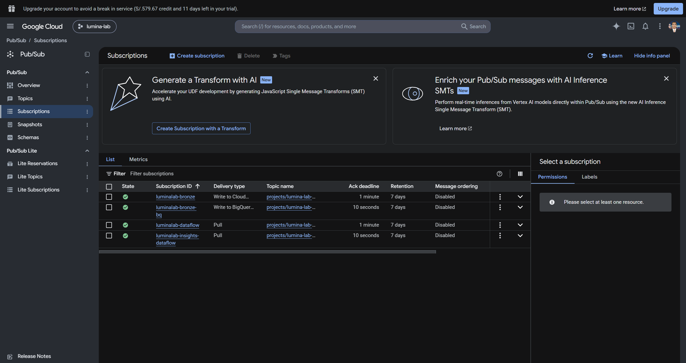

*Figura de referencia operativa. Vista prevista: nombre del tópico y ramas independientes de raw y Dataflow. Archivo de evidencia: `02-streaming/01-pubsub-topico-suscripciones.png`.*

**Figura EV-STR-02 — Ejecución Dataflow**

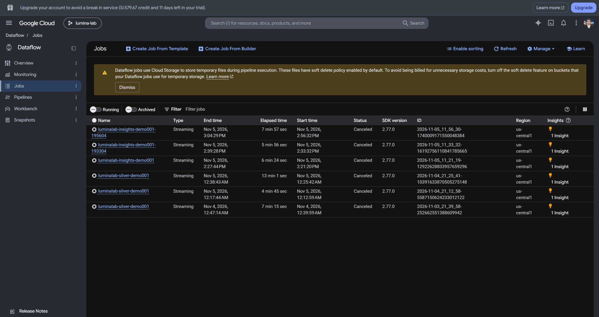

*Figura de referencia operativa. Vista prevista: job, región, worker y estado terminal. Archivo de evidencia: `02-streaming/02-dataflow-job.png`.*

**Figura EV-STR-03 — Evento correlacionado Bronze/Silver**

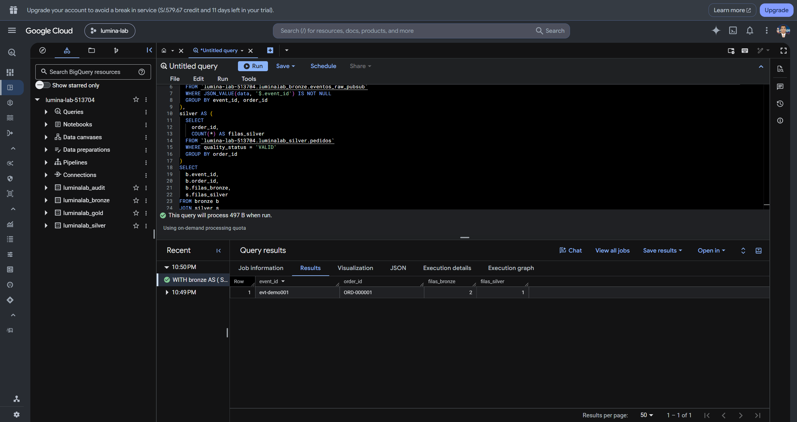

*Figura de referencia operativa. Vista prevista: mismo event_id y order_id en las consultas. Archivo de evidencia: `02-streaming/03-bq-bronze-silver-evento.png`.*

**Figura EV-STR-04 — Insights y auditoría**

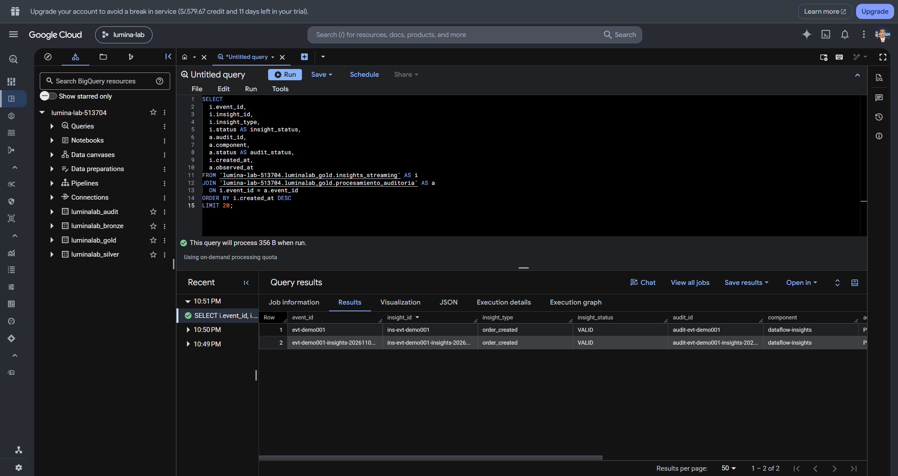

*Figura de referencia operativa. Vista prevista: mismo event_id en ambas tablas Gold. Archivo de evidencia: `03-insights/01-bq-insights-auditoria.png`.*


---

## 6. Implementación de pipelines batch

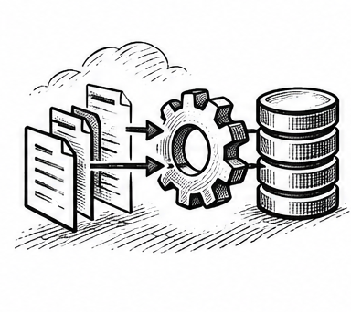

### Recorrido de procesamiento por lotes

Los archivos ingresan a Cloud Storage Landing. Bronze conserva procedencia, `batch_id`, URI, fila y controles de validez; Silver normaliza entidades; Gold publica agregaciones y Operational Mart. Workflows coordina dependencias y estados; no reemplaza por sí mismo el procesamiento SQL o Spark.

| Dominio | Tabla Bronze | Tabla Silver | Clave de negocio declarada |
|---|---|---|---|
| Pedidos | pedidos_raw | pedidos | order_id + order_line_id |
| Inventario | inventario_raw | inventario | snapshot_id |
| Entregas | entregas_raw | entregas | delivery_id |
| Competidores | benchmark_competidores_raw | benchmark_competidores | benchmark_id |
| Eventos locales | eventos_locales_raw | eventos_locales | local_event_id |
| Redes sociales | redes_sociales_raw | redes_sociales | post_id |

### Contrato de ejecución de lote

| Etapa | Entrada | Procesamiento | Salida y control |
|---|---|---|---|
| Identificación | archivo ad hoc | asignar `batch_id`, `file_id` y `record_hash` | referencia reproducible de archivo |
| Ingesta | archivo de Landing | cargar JSON y procedencia | `Bronze.*_raw` con `payload_json` e `is_valid` |
| Curación | `Bronze.*_raw` filtrado por `batch_id` | `JSON_VALUE`, `SAFE_CAST`, `MERGE` | seis entidades Silver y `quality_status` |
| Publicación | pedidos, inventario y entregas Silver | joins, cálculos y agregaciones | CU01–CU03 y `operational_mart` |
| Conciliación | identificador de ejecución | comparar conteos, nulos, duplicados y estado | acta y ejecución Workflows |

Los campos físicos del envelope Bronze, las claves de cada dominio y los esquemas de entrada se detallan en el anexo E.

**Cómputo bajo demanda:** Storage Transfer gestiona transferencias y Dataproc/Spark puede ejecutar transformaciones intensivas mediante clústeres efímeros, sujetos a políticas de finalización.

**Figura EV-BAT-01 — Landing y transferencia**

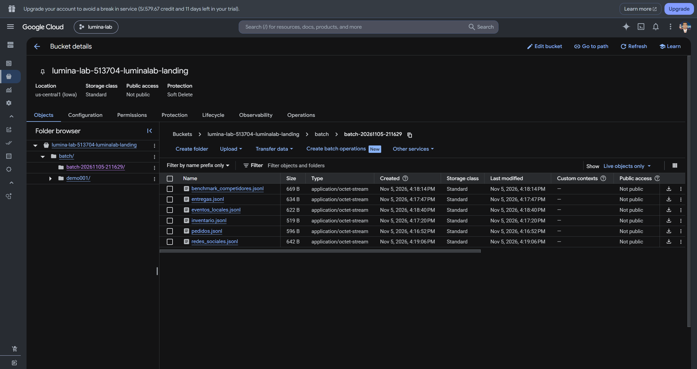

*Figura de referencia operativa. Vista prevista: objeto fuente, trabajo y transferencia completada. Archivo de evidencia: `04-batch/01-landing-transfer.png`.*

**Figura EV-BAT-02 — Ejecución Workflows**

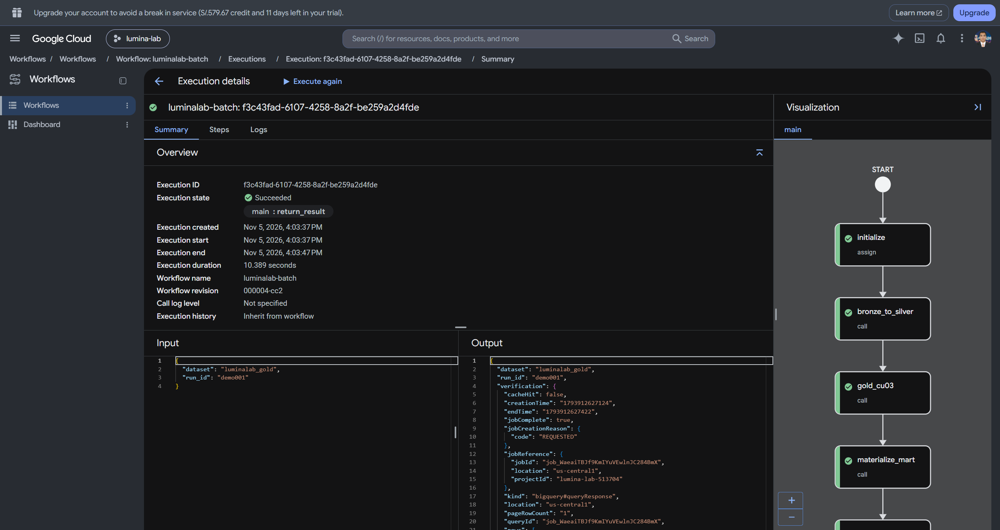

*Figura de referencia operativa. Vista prevista: revisión, cuenta y ejecución SUCCEEDED. Archivo de evidencia: `04-batch/02-workflow-execution.png`.*

**Figura EV-BAT-03 — Recorrido batch a Mart**

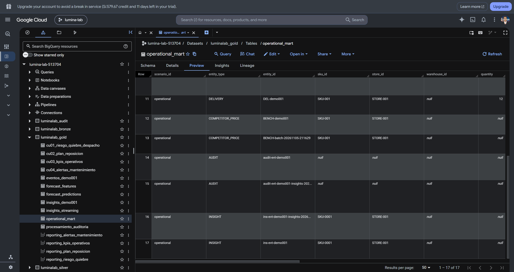

*Figura de referencia operativa. Vista prevista: mismo batch_id en Bronze, Silver, Gold y Mart. Archivo de evidencia: `04-batch/03-bq-batch-mart.png`.*


---

## 7. Transformación, calidad e integración


### Reglas de transformación verificables

| Regla | Ejemplo de entrada | Salida esperada | Comprobación |
|---|---|---|---|
| Tipado | cantidad como texto | cantidad numérica o rechazo | tipo físico y error |
| Normalización | identificador con espacios | clave canónica | comparación origen/destino |
| Integridad | pedido sin identificador | registro rechazado o marcado | conteo por calidad |
| Duplicidad | mismo event_id repetido | efecto controlado | consulta por event_id |
| Temporalidad | evento tardío | vigencia registrada | occurred_at vs emitted_at |
| Enriquecimiento | SKU y ubicación válidos | atributos asociados | join sustentado |
| Agregación | múltiples líneas por pedido | métrica a grano declarado | conciliación de importes |

Las reglas de calidad se trazan a su transformación SQL o función de procesamiento, junto con la prueba y el resultado registrado.

### Integración de dominios ad hoc

Los cruces entre pedidos, inventario, entregas y datos contextuales se realizan exclusivamente con claves y correspondencias definidas por los generadores propios. Se preservan la versión del escenario, la trazabilidad del lote o evento y la granularidad de cada entidad. Antes de relacionar ventas con múltiples eventos, los registros se agregan al grano compatible para evitar multiplicar unidades o importes.

### Indicadores de calidad

| Métrica | Fórmula | Interpretación |
|---|---|---|
| Completitud | campos obligatorios presentes / filas recibidas | calidad de origen |
| Duplicidad | claves repetidas / filas recibidas | idempotencia y control |
| Rechazos | filas inválidas / filas recibidas | incumplimiento contractual |
| Conciliación | filas aceptadas + rechazadas vs recibidas | integridad del lote |
| Oportunidad | tiempo de disponibilidad - occurred_at | latencia real |

**Prueba de integración:** registrar para al menos un evento y un lote las entradas, reglas, salidas y consultas antes/después, junto con el identificador de ejecución. Los porcentajes de desempeño se presentan únicamente cuando cuentan con medición reproducible.


---

## 8. Modelado analítico y productos Gold


### Modelo analítico y granularidad

| Producto Gold | Grano de consulta propuesto/documentado | Uso |
|---|---|---|
| cu01_riesgo_quiebre_despacho | escenario, SKU y tienda | riesgo y recomendación |
| cu02_plan_reposicion | escenario, SKU, almacén y fecha | planificación |
| cu03_kpis_operativos | escenario, periodo y canal | operación y SLA |
| cu04_alertas_mantenimiento | escenario, activo, sensor y almacén | mantenimiento |
| operational_mart | entity_type, entity_id, ingestion_mode, source_domain | integración transversal |

**Modelo dimensional:** identificar hechos, dimensiones, claves y relaciones físicas solo cuando el DDL y las consultas lo demuestren. El nombre Gold no implica automáticamente un esquema estrella. Se documentará el grano real de cada tabla, particiones, clustering, campos de medida y política de actualización.

### Forecast como capacidad complementaria

`moving_average_7d_baseline` demuestra la cadena `forecast_features` → `forecast_predictions` → `cu02_plan_reposicion`; el artefacto se conserva en el bucket Models bajo `forecast/DEMO_RUN_ID/MODEL_VERSION/model.json`. No se presenta como modelo predictivo final ni se infiere calidad sin evaluación.

### Vistas de reporting

Las vistas deben explicitar columnas, filtros, fuentes Gold y vigencia. El consumidor externo BI permanece fuera del alcance de aprovisionamiento.

**Figura EV-GOL-01 — Forecast, predicción y reposición**

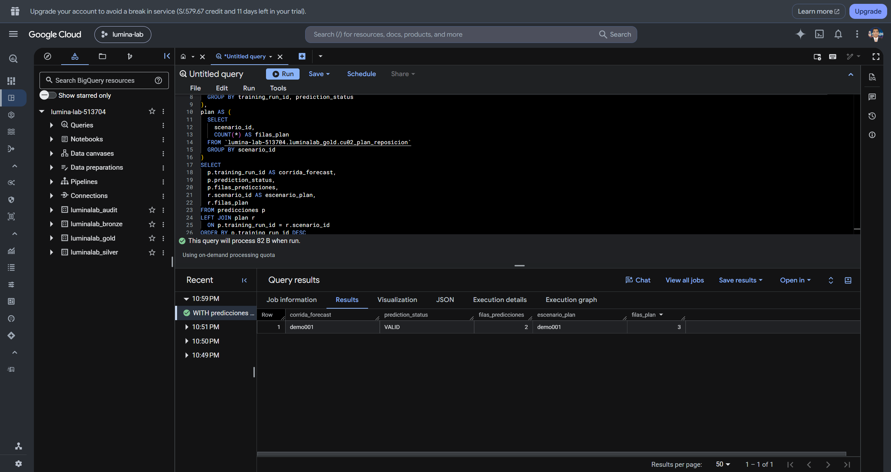

*Figura de referencia operativa. Vista prevista: identificador de corrida en features, predicción, plan y artefacto. Archivo de evidencia: `05-forecast/01-features-predicciones-plan.png`.*

**Figura EV-GOL-02 — Vistas analíticas Gold**

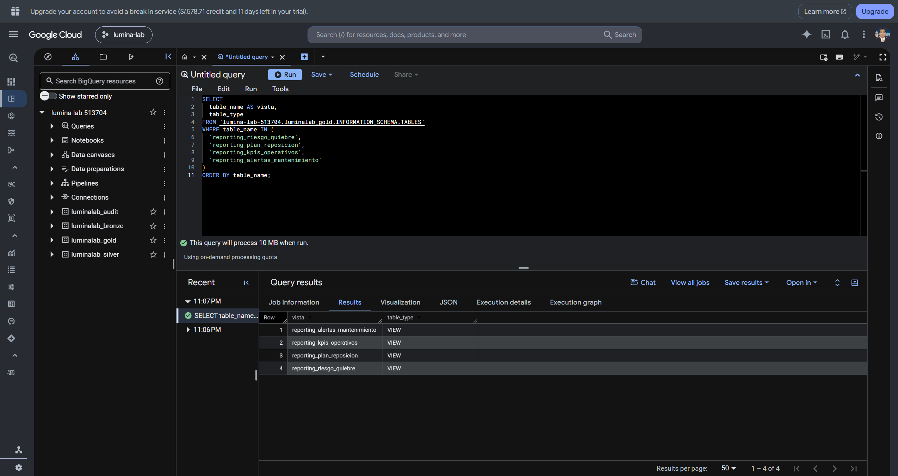

*Figura de referencia operativa. Vista prevista: vistas y consultas con resultados. Archivo de evidencia: `06-consumo/03-bigquery-vistas.png`.*


---

## 9. Exposición y consumo de datos


### Contratos de consumo

Cloud Run expone una API privada con autenticación IAM, mínimo cero instancias, máximo dos y límite documentado de 100 filas por solicitud. La integración con consumidores externos se gestiona mediante contratos independientes. Una respuesta de `/healthz` no demuestra la funcionalidad de las rutas de negocio.

| Método y ruta | Entrada HTTP | Fuente BigQuery | Salida JSON |
|---|---|---|---|
| `GET /api/v1/insights` | `limit`, `scenario_id` opcional | `insights_streaming`, CU01 | `streaming_insights[]`, `stockout_risks[]`, `counts`, `scenario_id` |
| `GET /api/v1/kpis` | mismos parámetros | CU03 | `data[]`, `count`, `source_table`, `scenario_id` |
| `GET /api/v1/inventory-plans` | mismos parámetros | CU02 | mismo envelope `data[]` |
| `GET /api/v1/maintenance-risks` | mismos parámetros | CU04 | mismo envelope `data[]` |
| `GET /healthz` | sin parámetros | ninguna | `{"status":"ok"}` |

| Regla transversal | Contrato |
|---|---|
| Autenticación | token de identidad y permiso IAM de invocación Cloud Run |
| `limit` | entero entre 1 y 100; valor predeterminado 25 |
| `scenario_id` | cadena opcional de hasta 128 caracteres conforme al patrón definido en el anexo C |
| Errores de aplicación | HTTP 400 `invalid_query`, 404 `route_not_found`, 405 `method_not_allowed`, 500 `query_failed` |

Las respuestas y los errores se derivan de `soluciones/api-insights/main.py`; el anexo C presenta los contratos completos.

**Figura EV-API-01 — Servicio Cloud Run privado**

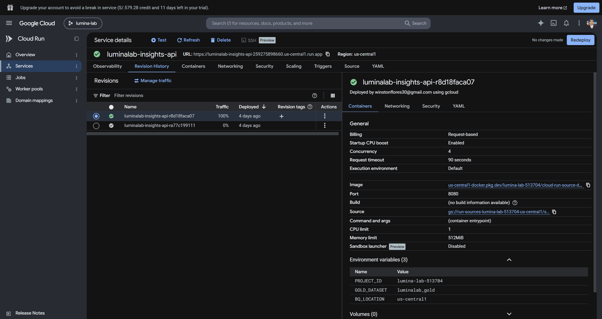

*Figura de referencia operativa. Vista prevista: revisión READY, región, identidad y autenticación. Archivo de evidencia: `06-consumo/01-cloud-run-servicio.png`.*

**Figura EV-API-02 — Respuestas de negocio**

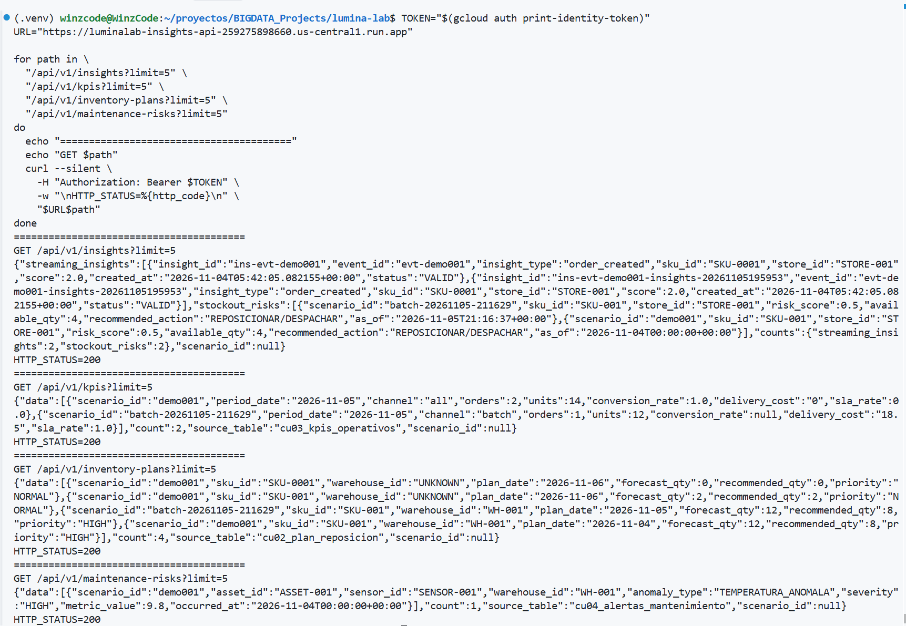

*Figura de referencia operativa. Vista prevista: HTTP 200 autenticado de las cuatro rutas. Archivo de evidencia: `06-consumo/02-api-rutas.png`.*


---

## 10. Seguridad, gobierno y observabilidad


### Controles transversales

| Dominio | Componentes previstos/documentados | Evidencia que acredita |
|---|---|---|
| Gobierno | Dataplex y Data Lineage | activos y relaciones entre fuentes y vistas |
| Identidades | IAM por servicio | permisos mínimos worker, workflow y API |
| Cifrado | KMS y Secret Manager | claves, secreto protegido y referencias sin revelar valores |
| Protección | plantilla DLP regional | configuración de detectores EMAIL, PHONE, CARD |
| Auditoría | Logging sink y BigQuery Audit Store | registro de prueba consultable |
| Observabilidad | Monitoring, alertas y SLO | métrica, política, objetivo y estado |

**Verificación:** el control de auditoría relaciona eventos de origen, exportación al almacén de auditoría y consulta de registros. La disponibilidad del 99 % se establece como objetivo de servicio.

**Figura EV-SEC-01 — Gobierno y cifrado**

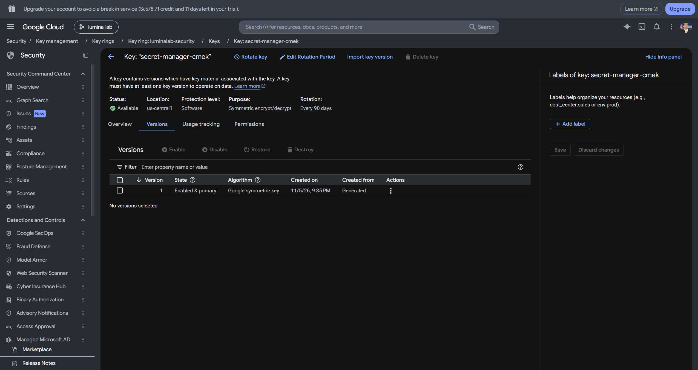

*Captura disponible: KMS y seguridad, sin mostrar valores de secretos. Archivo: `07-controles/03-seguridad-kms.png`.*

**Figura EV-SEC-02 — Auditoría y monitoreo**

Evidencia no incluida en esta entrega.


---

## 11. Validación end-to-end y resultados


### Matriz de aceptación de la solución

| Prueba | Criterio de aceptación | Evidencia esperada | IDs / conteos observados | Estado | Observación |
|---|---|---|---|---|---|
| VAL-STR-01 | Mismo `event_id` en Bronze y Silver | EV-STR-03 | Captura cargada | DOCUMENTADO | Consulta ejecutada en BigQuery |
| VAL-STR-02 | Mismo `event_id` en Insights y auditoría Gold | EV-STR-04 | Captura cargada | DOCUMENTADO | Consulta ejecutada en BigQuery |
| VAL-BAT-01 | Recorrido Bronze → Silver → Gold/Mart con `batch_id` | EV-BAT-03 | Captura cargada | DOCUMENTADO | Resultado batch cargado |
| VAL-TRF-01 | Tipado, rechazo y deduplicación | SQL y resultado antes/después | No observados | BLOQUEADO | No se inspeccionaron resultados de ejecución |
| VAL-INT-01 | Joins por claves sustentadas | SQL y resultado integrado | No observados | BLOQUEADO | No se inspeccionaron resultados ni cardinalidades |
| VAL-MOD-01 | Producto Gold con grano y medidas validados | EV-GOL-02 | Captura cargada | DOCUMENTADO | Vistas Gold consultadas |
| VAL-API-01 | API autenticada con respuesta HTTP 200 válida | EV-API-02 | Captura cargada | DOCUMENTADO | Cuatro rutas autenticadas verificadas |

**Estado de la entrega:** se incorporaron las capturas PNG disponibles en `assets/evidencia/`. Esta entrega cierra la evidencia disponible para fundación, streaming, batch, forecast, API, vistas Gold y seguridad KMS. La captura de auditoría y observabilidad no se incluye en esta etapa; tampoco se incluyen capturas de gobierno/lineage si no fueron cargadas como PNG.

Para reanudar el levantamiento se requiere una sesión de consola GCP accesible o un entorno autenticado con `gcloud` y `bq` disponibles y permisos de lectura sobre el proyecto `retailsmart-bigdata`. Cualquier consulta o acción no incluida en lectura seguirá sujeta al control de costos y autorización definido en este informe.

### Procedimiento reproducible

1. Preparar `config.env` desde `config.env.example`, sin versionar secretos.
2. Ejecutar `bash automatizacion/scripts/00_runbook.sh` para validar inventario local; **no crea recursos**.
3. Ejecutar grupos conforme a `automatizacion/configuracion/runbook.json`.
4. Registrar IDs de recursos, ejecuciones, consultas, conteos y errores.
5. Cancelar los jobs Dataflow de demostración y verificar estado terminal.
6. No ejecutar el script 90 de eliminación como parte del recorrido estándar.

Las figuras SVG grises señalan el archivo PNG real esperado y son **placeholders**, no pruebas. Antes de entrega formal al cliente, sustituirlas y actualizar la matriz con el resultado observado.


---

## 12. Conclusiones y hoja de evolución


### Resultado documental y límites

La plataforma Lumina Retail integra procesamiento híbrido sobre BigQuery Medallion, con componentes de ingesta, curación, productos Gold, API y controles transversales. La demostración de éxito debe apoyarse en consultas y pruebas de datos, no en el inventario de servicios.

**Decisiones pendientes de operación productiva:** cuotas, costos, retención, escalamiento, SLAs, gobernanza de contratos, monitoreo de calidad, consumidores externos y dimensionamiento. No se extrapolan resultados de una demo con un worker a campañas masivas.

### Hoja de evolución

Priorizar (1) cerrar trazabilidad streaming y batch con evidencias; (2) consolidar diccionarios físicos y contratos versionados; (3) automatizar pruebas de calidad y conciliación; (4) medir latencia/costo bajo escenarios controlados; (5) incorporar consumidores externos con contratos independientes. Las decisiones de arquitectura y sus modificaciones se mantendrán en el registro de decisiones técnicas.

---

## Anexo A. Inventario de interfaces y recursos

| Componente | Entrada física | Operación | Salida física | Referencia de implementación |
|---|---|---|---|---|
| Generador de eventos | contrato JSON ad hoc | normaliza, asigna event_id y publica | tópico Pub/Sub de eventos | `08_publicar_evento.sh` |
| Pub/Sub | JSON de evento | distribuye a tres suscripciones | Dataflow pull, BigQuery raw, GCS JSONL | `05_crear_topicos_y_suscripciones.sh` |
| Dataflow | suscripción pull | valida y transforma | tablas Silver | `07_iniciar_dataflow.sh` |
| Carga batch | archivos ad hoc en Landing | parseo, carga, control de lote | BigQuery Bronze | `55_generar_y_publicar_fixtures_batch.sh`, `56_cargar_seis_fuentes_bronze.sh` |
| Curación SQL | Bronze por batch_id | SAFE_CAST, reglas, MERGE | seis tablas Silver | `57_curar_seis_fuentes_y_gold.sh` |
| Materialización Gold | Silver validada | joins, agregaciones, cálculos | CU01–CU03, Operational Mart | `57_curar_seis_fuentes_y_gold.sh` |
| API Cloud Run | GET autenticado, filtros | consultas parametrizadas | JSON de productos Gold | `soluciones/api-insights/main.py` |
| Workflows | definición y parámetros de ejecución | orquestación batch | estado de ejecución y tablas destino | scripts 49–53 |
| Gobierno y observabilidad | metadatos, logs, métricas | catálogo, controles y auditoría | linaje, alertas, Audit Store | scripts 70–83 |

Los nombres de proyecto, prefijo, región y datasets son parametrizados. Esta tabla describe las **interfaces implementadas en código**; la comprobación del estado efectivo de GCP se conserva en las actas de operación.


---

## Anexo B. Contratos de eventos y mensajería

### B.1 Evento de pedido: entrada real del generador

Fuente versionada: `docs/arquitectura/contrato-evento-original.json`. El script 08 actualiza `event_id`, `simulation_id`, `trace_id` y timestamps para la ejecución; el payload del contrato es:

```json
{
  "schema_version": "1.0.0",
  "simulation_id": "sim-20261103-001",
  "scenario_id": "black-friday",
  "producer_id": "channel-apps",
  "event_type": "order_created",
  "event_id": "evt-000001",
  "occurred_at": "2026-11-03T10:00:00Z",
  "emitted_at": "2026-11-03T10:00:01Z",
  "trace_id": "trace-order-000001",
  "payload": {
    "order_id": "ORD-000001",
    "customer_id": "CUS-000001",
    "store_id": "STORE-001",
    "product_id": "SKU-0001",
    "quantity": 2
  }
}
```

| Campo | Tipo lógico | Semántica | Tratamiento |
|---|---|---|---|
| schema_version | string | versión del envelope | conservar y validar compatibilidad |
| simulation_id / scenario_id | string | simulación y escenario | segmentación de pruebas |
| producer_id | string | generador ad hoc | trazabilidad |
| event_type | string | tipo de evento, p. ej. order_created | enrutamiento |
| event_id | string | identificador del evento | correlación y duplicados |
| occurred_at / emitted_at | timestamp ISO 8601 | momento de negocio y publicación | parseo temporal |
| trace_id | string | seguimiento distribuido | correlación |
| payload.order_id | string | pedido | clave de negocio |
| payload.customer_id | string | cliente simulado | atributo de negocio |
| payload.store_id | string | tienda | dimensión |
| payload.product_id | string | SKU en el contrato original | atención: no confundir con `sku_id` de Silver |
| payload.quantity | número | unidades | entero positivo según validación de destino |

**Observación de compatibilidad:** el contrato original usa `product_id`, mientras la tabla Silver `pedidos` utiliza `sku_id`. La correspondencia debe demostrarse en el transformador real; no se presume equivalencia automática.

### B.2 Topología y destinos

| Suscripción | Tipo | Input | Output | Consideración |
|---|---|---|---|---|
| `$DF_SUB` | pull | tópico `$TOPIC` | Dataflow → Silver | ack deadline 60 s; no efectuar pull manual |
| `$RAW_BQ_SUB` | export BigQuery | tópico `$TOPIC` | `Bronze.eventos_raw_pubsub` | `writeMetadata=true` |
| `$RAW_SUB` | export Cloud Storage | tópico `$TOPIC` | bucket `$BRONZE`, `streaming/*.jsonl` | archivos JSONL, rotación de 60 s |

Además, el script 05 crea `$INSIGHTS_TOPIC` y `$AUDIT_TOPIC`; sus contratos de mensaje deben cotejarse con los publicadores y consumidores correspondientes. La suscripción export a GCS es una **tercera rama**, además de Dataflow y BigQuery, que debe aparecer en el diagrama operativo.

### B.3 Salida raw de Pub/Sub a BigQuery

| Columna | Tipo BigQuery | Contenido |
|---|---|---|
| data | JSON | mensaje publicado |
| subscription_name | STRING | suscripción exportadora |
| message_id | STRING | identificador Pub/Sub |
| publish_time | TIMESTAMP | publicación |
| attributes | JSON | atributos Pub/Sub |
| ordering_key | STRING | clave de orden si existe |

**Verificación:** publicar `evt-${DEMO_RUN_ID}` y consultar el mensaje en Bronze, contrastando su `event_id` con el registro Silver. La confirmación de publicación no demuestra por sí sola materialización.


---

## Anexo C. Contratos REST de consumo

**Implementación de referencia:** `soluciones/api-insights/main.py`. Todas las rutas usan **GET** y entregan `application/json; charset=utf-8`. El servicio Cloud Run exige invocación autenticada con IAM.

### C.1 Parámetros compartidos

| Parámetro | Tipo | Default | Regla |
|---|---|---|---|
| limit | integer | 25 | 1–100 inclusive |
| scenario_id | string opcional | null | expresión `^[A-Za-z0-9][A-Za-z0-9._:-]{0,127}$` |

La API consulta BigQuery con parámetros enlazados, límite de facturación **52 428 800 bytes por consulta** y timeout de resultados de **60 segundos**. `scenario_id` filtra tablas CU01–CU04; **no filtra** `insights_streaming`.

### C.2 Operaciones y respuesta

| Método y ruta | Tablas de entrada | Output JSON |
|---|---|---|
| GET /healthz | ninguna | `{"status":"ok"}` |
| GET /api/v1/insights | insights_streaming + cu01_riesgo_quiebre_despacho | `streaming_insights[]`, `stockout_risks[]`, `counts`, `scenario_id` |
| GET /api/v1/kpis | cu03_kpis_operativos | `data[]`, `count`, `source_table`, `scenario_id` |
| GET /api/v1/inventory-plans | cu02_plan_reposicion | mismo envelope `data[]` |
| GET /api/v1/maintenance-risks | cu04_alertas_mantenimiento | mismo envelope `data[]` |

**Ejemplo de estructura de respuesta** (valores ilustrativos, forma derivada del código):

```json
{"data":[],"count":0,"source_table":"cu03_kpis_operativos","scenario_id":"demo"}
```

**Ejemplo de estructura Insights:**

```json
{"streaming_insights":[],"stockout_risks":[],"counts":{"streaming_insights":0,"stockout_risks":0},"scenario_id":null}
```

### C.3 Errores contractuales

| HTTP | Body | Condición |
|---|---|---|
| 400 | `{"error":"invalid_query","message":"..."}` | limit o scenario_id inválido |
| 404 | `{"error":"route_not_found"}` | ruta inexistente |
| 405 | `{"error":"method_not_allowed"}` | método distinto de GET; header Allow: GET |
| 500 | `{"error":"query_failed"}` | error de consulta BigQuery |

Los rechazos de acceso anónimo 401/403 se gestionan en la capa Cloud Run, antes de la aplicación. El verificador `66_verificar_api_retailsmart.sh` exige respuestas HTTP 200 **con al menos una fila** en las cuatro rutas y valida que la API no sea accesible anónimamente.

### C.4 Campos de salida por producto

- **insights_streaming:** `insight_id, event_id, insight_type, sku_id, store_id, score, created_at, status`.
- **cu01_riesgo_quiebre_despacho:** `scenario_id, sku_id, store_id, risk_score, available_qty, recommended_action, as_of`.
- **cu02_plan_reposicion:** `scenario_id, sku_id, warehouse_id, plan_date, forecast_qty, recommended_qty, priority`.
- **cu03_kpis_operativos:** `scenario_id, period_date, channel, orders, units, conversion_rate, delivery_cost, sla_rate`.
- **cu04_alertas_mantenimiento:** `scenario_id, asset_id, sensor_id, warehouse_id, anomaly_type, severity, metric_value, occurred_at`.


---

## Anexo D. Diccionario físico de datos

Los siguientes campos y tipos provienen de las sentencias `CREATE TABLE IF NOT EXISTS` de los scripts 04, 31, 44 y `gold_tables.sql`. `NOT NULL` es la restricción declarada en el DDL. Los esquemas de tablas creadas en otros scripts se deben incorporar con el mismo método; este catálogo no sustituye una extracción del catálogo efectivo de BigQuery.

### `<project>.<dataset>.eventos_raw\`

| Campo | Tipo y restricción |
|---|---|
| `schema_version` | STRING NOT NULL |
| `simulation_id` | STRING NOT NULL |
| `scenario_id` | STRING NOT NULL |
| `producer_id` | STRING NOT NULL |
| `event_type` | STRING NOT NULL |
| `event_id` | STRING NOT NULL |
| `occurred_at` | TIMESTAMP NOT NULL |
| `emitted_at` | TIMESTAMP NOT NULL |
| `ingested_at` | TIMESTAMP |
| `trace_id` | STRING NOT NULL |
| `source_system` | STRING |
| `payload_json` | JSON |
| `is_valid` | BOOL |

### `<project>.<dataset>.eventos_raw_pubsub\`

| Campo | Tipo y restricción |
|---|---|
| `data` | JSON |
| `subscription_name` | STRING |
| `message_id` | STRING |
| `publish_time` | TIMESTAMP |
| `attributes` | JSON |
| `ordering_key` | STRING |

### `<project>.<dataset>.${table}_raw\`

| Campo | Tipo y restricción |
|---|---|
| `batch_id` | STRING NOT NULL |
| `file_id` | STRING NOT NULL |
| `source_file_uri` | STRING NOT NULL |
| `source_system` | STRING NOT NULL |
| `source_row_number` | INT64 NOT NULL |
| `ingested_at` | TIMESTAMP NOT NULL |
| `effective_at` | TIMESTAMP |
| `record_hash` | STRING NOT NULL |
| `payload_json` | JSON NOT NULL |
| `is_valid` | BOOL NOT NULL |
| `error_reason` | STRING |

### `<project>.<dataset>.pedidos\`

| Campo | Tipo y restricción |
|---|---|
| `order_id` | STRING NOT NULL |
| `order_line_id` | STRING |
| `customer_id` | STRING |
| `store_id` | STRING |
| `warehouse_id` | STRING |
| `sku_id` | STRING NOT NULL |
| `quantity` | INT64 NOT NULL |
| `occurred_at` | TIMESTAMP NOT NULL |
| `quality_status` | STRING NOT NULL |

### `<project>.<dataset>.inventario\`

| Campo | Tipo y restricción |
|---|---|
| `snapshot_id` | STRING NOT NULL |
| `warehouse_id` | STRING NOT NULL |
| `store_id` | STRING |
| `sku_id` | STRING NOT NULL |
| `on_hand_qty` | INT64 NOT NULL |
| `reserved_qty` | INT64 NOT NULL |
| `effective_at` | TIMESTAMP NOT NULL |
| `quality_status` | STRING NOT NULL |

### `<project>.<dataset>.entregas\`

| Campo | Tipo y restricción |
|---|---|
| `delivery_id` | STRING NOT NULL |
| `order_id` | STRING NOT NULL |
| `store_id` | STRING |
| `region_id` | STRING |
| `promised_at` | TIMESTAMP |
| `delivered_at` | TIMESTAMP |
| `delivery_cost` | NUMERIC |
| `quality_status` | STRING NOT NULL |

### `<project>.<dataset>.telemetria_activos\`

| Campo | Tipo y restricción |
|---|---|
| `asset_id` | STRING NOT NULL |
| `sensor_id` | STRING NOT NULL |
| `warehouse_id` | STRING |
| `store_id` | STRING |
| `metric_name` | STRING NOT NULL |
| `metric_value` | FLOAT64 NOT NULL |
| `unit` | STRING NOT NULL |
| `occurred_at` | TIMESTAMP NOT NULL |
| `quality_status` | STRING NOT NULL |

### `<project>.<dataset>.$table\`

| Campo | Tipo y restricción |
|---|---|
| `batch_id` | STRING NOT NULL |
| `file_id` | STRING NOT NULL |
| `source_file_uri` | STRING NOT NULL |
| `source_system` | STRING NOT NULL |
| `source_row_number` | INT64 NOT NULL |
| `ingested_at` | TIMESTAMP NOT NULL |
| `effective_at` | TIMESTAMP |
| `record_hash` | STRING NOT NULL |
| `payload_json` | JSON NOT NULL |
| `is_valid` | BOOL NOT NULL |
| `error_reason` | STRING |

### `<project>.<dataset>.benchmark_competidores\`

| Campo | Tipo y restricción |
|---|---|
| `benchmark_id` | STRING NOT NULL |
| `competitor_id` | STRING NOT NULL |
| `sku_id` | STRING NOT NULL |
| `store_id` | STRING |
| `observed_at` | TIMESTAMP NOT NULL |
| `competitor_price` | NUMERIC NOT NULL |
| `availability` | STRING |
| `quality_status` | STRING NOT NULL |

### `<project>.<dataset>.eventos_locales\`

| Campo | Tipo y restricción |
|---|---|
| `local_event_id` | STRING NOT NULL |
| `store_id` | STRING NOT NULL |
| `event_type` | STRING NOT NULL |
| `start_at` | TIMESTAMP NOT NULL |
| `end_at` | TIMESTAMP |
| `impact_score` | FLOAT64 NOT NULL |
| `quality_status` | STRING NOT NULL |

### `<project>.<dataset>.redes_sociales\`

| Campo | Tipo y restricción |
|---|---|
| `post_id` | STRING NOT NULL |
| `platform` | STRING NOT NULL |
| `published_at` | TIMESTAMP NOT NULL |
| `sku_id` | STRING NOT NULL |
| `sentiment_score` | FLOAT64 NOT NULL |
| `engagement_count` | INT64 NOT NULL |
| `text_hash` | STRING NOT NULL |
| `quality_status` | STRING NOT NULL |

### `<project>.<dataset>.insights_streaming\`

| Campo | Tipo y restricción |
|---|---|
| `insight_id` | STRING NOT NULL |
| `event_id` | STRING NOT NULL |
| `insight_type` | STRING NOT NULL |
| `sku_id` | STRING |
| `store_id` | STRING |
| `score` | FLOAT64 |
| `created_at` | TIMESTAMP NOT NULL |
| `status` | STRING NOT NULL |

### `<project>.<dataset>.procesamiento_auditoria\`

| Campo | Tipo y restricción |
|---|---|
| `audit_id` | STRING NOT NULL |
| `event_id` | STRING NOT NULL |
| `component` | STRING NOT NULL |
| `status` | STRING NOT NULL |
| `observed_at` | TIMESTAMP NOT NULL |
| `detail` | STRING |

### `<project>.<dataset>.cu01_riesgo_quiebre_despacho`

| Campo | Tipo y restricción |
|---|---|
| `scenario_id` | STRING |
| `sku_id` | STRING |
| `store_id` | STRING |
| `risk_score` | FLOAT64 |
| `available_qty` | INT64 |
| `recommended_action` | STRING |
| `as_of` | TIMESTAMP |

### `<project>.<dataset>.cu02_plan_reposicion`

| Campo | Tipo y restricción |
|---|---|
| `scenario_id` | STRING |
| `sku_id` | STRING |
| `warehouse_id` | STRING |
| `plan_date` | DATE |
| `forecast_qty` | INT64 |
| `recommended_qty` | INT64 |
| `priority` | STRING |

### `<project>.<dataset>.cu03_kpis_operativos`

| Campo | Tipo y restricción |
|---|---|
| `scenario_id` | STRING |
| `period_date` | DATE |
| `channel` | STRING |
| `orders` | INT64 |
| `units` | INT64 |
| `conversion_rate` | FLOAT64 |
| `delivery_cost` | NUMERIC |
| `sla_rate` | FLOAT64 |

### `<project>.<dataset>.cu04_alertas_mantenimiento`

| Campo | Tipo y restricción |
|---|---|
| `scenario_id` | STRING |
| `asset_id` | STRING |
| `sensor_id` | STRING |
| `warehouse_id` | STRING |
| `anomaly_type` | STRING |
| `severity` | STRING |
| `metric_value` | FLOAT64 |
| `occurred_at` | TIMESTAMP |


**Controles de integridad:** BigQuery no garantiza unicidad mediante estas definiciones; la idempotencia se implementa en MERGE y filtros de ejecución. La nulabilidad y los esquemas reales deben contrastarse con `INFORMATION_SCHEMA.COLUMNS` cuando haya recursos desplegados.


---

## Anexo E. Contratos de archivos y procesamiento batch

Fuente versionada: `automatizacion/configuracion/contratos/batch_sources.json` (v1.0). **Todos los dominios corresponden a fixtures propios ad hoc**, aunque sus nombres de productor simulen sistemas empresariales.

| Dominio | Productor simulado | Entrada (payload JSON) | Clave | Destino Bronze → Silver |
|---|---|---|---|---|
| pedidos | Sistema de Pedidos | `order_id, order_line_id, customer_id, store_id, warehouse_id, sku_id, quantity, occurred_at` | `order_id + order_line_id` | `pedidos_raw` → `pedidos` |
| inventario | ERP / Sistema de Inventario | `warehouse_id, store_id, sku_id, on_hand_qty, reserved_qty, effective_at` | `snapshot_id` | `inventario_raw` → `inventario` |
| entregas | Aplicación de Almacenes | `delivery_id, order_id, store_id, region_id, promised_at, delivered_at, delivery_cost` | `delivery_id` | `entregas_raw` → `entregas` |
| benchmark_competidores | Benchmark Competidores | `benchmark_id, competitor_id, sku_id, store_id, observed_at, competitor_price, availability, source_uri` | `benchmark_id` | `benchmark_competidores_raw` → `benchmark_competidores` |
| eventos_locales | Eventos Locales | `local_event_id, store_id, event_type, start_at, end_at, impact_score, source_uri` | `local_event_id` | `eventos_locales_raw` → `eventos_locales` |
| redes_sociales | Redes Sociales | `post_id, platform, published_at, sku_id, sentiment_score, engagement_count, text_hash, source_uri` | `post_id` | `redes_sociales_raw` → `redes_sociales` |

### E.1 Envelope físico Bronze para lotes

Las tablas `*_raw` usan el mismo esquema:

| Campo | Tipo | Significado |
|---|---|---|
| batch_id | STRING NOT NULL | ejecución lógica |
| file_id | STRING NOT NULL | identificador de archivo |
| source_file_uri | STRING NOT NULL | URI de procedencia |
| source_system | STRING NOT NULL | productor simulado |
| source_row_number | INT64 NOT NULL | fila de origen |
| ingested_at | TIMESTAMP NOT NULL | hora de ingesta |
| effective_at | TIMESTAMP | vigencia del dato |
| record_hash | STRING NOT NULL | huella del registro |
| payload_json | JSON NOT NULL | contenido original |
| is_valid | BOOL NOT NULL | aceptación de entrada |
| error_reason | STRING | detalle de rechazo |

### E.2 Ejemplo de transformación física: inventario

**Input:** `Bronze.inventario_raw.payload_json` con `warehouse_id`, `store_id`, `sku_id`, `on_hand_qty`, `reserved_qty`. **Transformación:** `SAFE_CAST` de cantidades a INT64, derivación de `snapshot_id=batch_id:file_id:source_row_number`, evaluación `on_hand_qty >= reserved_qty`. **Output:** `Silver.inventario(snapshot_id, warehouse_id, store_id, sku_id, on_hand_qty, reserved_qty, effective_at, quality_status)`. **Persistencia:** `MERGE` por snapshot_id.

**Advertencia de calidad:** el SQL revisado asigna `quality_status='INVALID'` cuando falla la regla, pero el `MERGE` no descarta automáticamente la fila inválida; el filtrado a `VALID` se realiza en los productos Gold examinados.


---

## Anexo F. Mapeo de transformaciones y reglas de calidad

Fuente: `automatizacion/scripts/57_curar_seis_fuentes_y_gold.sh`.

| Input Bronze | Transformación implementada | Output Silver | Regla de calidad |
|---|---|---|---|
| pedidos_raw.payload_json | JSON_VALUE + SAFE_CAST(quantity AS INT64), MERGE por order_id/order_line_id | pedidos | is_valid y quantity > 0 |
| inventario_raw.payload_json | SAFE_CAST cantidades, snapshot_id derivado, MERGE | inventario | on_hand_qty >= reserved_qty |
| entregas_raw.payload_json | SAFE_CAST fechas y delivery_cost, MERGE por delivery_id | entregas | delivery_cost >= 0 |
| benchmark_competidores_raw.payload_json | SAFE_CAST observed_at y competitor_price | benchmark_competidores | competitor_price > 0 |
| eventos_locales_raw.payload_json | SAFE_CAST timestamps e impact_score | eventos_locales | impact_score entre 0 y 1 |
| redes_sociales_raw.payload_json | SAFE_CAST published_at, sentiment_score, engagement_count | redes_sociales | sentiment_score entre -1 y 1; engagement_count >= 0 |

**Semántica de salida:** los seis `MERGE` insertan registros nuevos y no incluyen `WHEN MATCHED THEN UPDATE`. El control de idempotencia depende de las claves del ON y de la calidad del conjunto fuente; los scripts no demuestran por sí mismos deduplicación previa cuando hay múltiples filas fuente con la misma clave.

### F.1 Transformación Silver → Gold

| Input | Operación SQL observada | Output |
|---|---|---|
| inventario + pedidos | JOIN por sku_id; cálculo de disponibilidad y riesgo | CU01 riesgo de quiebre |
| pedidos + inventario | JOIN por sku_id; SUM(quantity), diferencia contra disponible | CU02 reposición |
| pedidos LEFT JOIN entregas | COUNT DISTINCT, SUM, costo y tasa de entrega | CU03 KPIs |
| pedidos + inventario | proyección por entity_type, entity_id y ingestion_mode | operational_mart |

**Riesgo técnico identificado:** los JOIN por `sku_id` sin otras claves de ubicación o control de cardinalidad pueden multiplicar filas cuando existen múltiples tiendas, almacenes o snapshots para el mismo SKU. Antes de certificar métricas, se deben ejecutar pruebas de cardinalidad y conciliación por escenario.


---

## Anexo G. Contratos de productos analíticos Gold

| Producto | Input | Regla de negocio | Output | Consumidor |
|---|---|---|---|---|
| CU01 | Silver inventario + pedidos válidos | disponible = on_hand_qty − reserved_qty; umbral 12 para recomendación | scenario_id, sku_id, store_id, risk_score, available_qty, recommended_action, as_of | API Insights |
| CU02 | Silver pedidos + inventario válidos | SUM(quantity) y faltante contra disponible | scenario_id, sku_id, warehouse_id, plan_date, forecast_qty, recommended_qty, priority | API inventory-plans |
| CU03 | Silver pedidos + entregas | conteos, unidades, costo, SLA calculado | scenario_id, period_date, channel, orders, units, conversion_rate, delivery_cost, sla_rate | API kpis |
| CU04 | telemetría de activos | reglas de mantenimiento del pipeline correspondiente | scenario_id, asset_id, sensor_id, warehouse_id, anomaly_type, severity, metric_value, occurred_at | API maintenance-risks |
| insights_streaming | evento del tópico Insights | clasificador/generador de insights | insight_id, event_id, insight_type, sku_id, store_id, score, created_at, status | API Insights |
| procesamiento_auditoria | eventos procesados | registro de procesamiento | audit_id, event_id, component, status, observed_at, detail | auditoría |

**Control de alcance:** las transformaciones exactas de CU04 e Insights se documentarán a partir de sus respectivos pipelines; no se atribuyen al script batch 57, que materializa CU01–CU03 y Operational Mart.


---

## Anexo H. Metadatos, linaje y controles operativos

| Flujo | Correlación | Punto de entrada | Punto de salida | Verificación |
|---|---|---|---|---|
| Evento | event_id, trace_id | Pub/Sub | Bronze raw, Silver | coincidencia de identificador |
| Batch | batch_id, file_id, source_row_number | GCS Landing | Bronze/Silver/Gold | conciliación de filas |
| Forecast | DEMO_RUN_ID, model_version | Gold features | predictions, plan y model.json | versión y horizonte |
| API | revisión Cloud Run, scenario_id | GET autenticado | JSON de tablas Gold | HTTP y count |
| Auditoría | event_id, audit_id | pipeline Insights | procesamiento_auditoria | evento y estado |

**Seguridad:** la API Cloud Run se despliega con `--no-allow-unauthenticated`, cuenta de servicio dedicada, CPU 1, memoria 512 MiB, concurrencia 4, timeout 90 s, min 0 y max 2 instancias. El verificador 66 comprueba identidad, revisión READY, rechazo anónimo y cuatro respuestas de negocio.


---

## Anexo I. Pruebas de contrato e integración

| ID | Input de prueba | Resultado esperado | Evidencia técnica |
|---|---|---|---|
| EVT-01 | evento del contrato JSON con event_id único | publicación Pub/Sub y registro raw | `08_publicar_evento.sh` + consulta Bronze |
| EVT-02 | mismo evento | registro Silver con correlación | `09_verificar_silver_y_bronze.sh` |
| BAT-01 | fixtures ad hoc de seis dominios | carga raw con batch_id y conteos | scripts 55–56 |
| BAT-02 | batch_id anterior | seis entidades Silver tipadas y calidad | script 57 y consultas |
| BAT-03 | Silver válida | CU01–CU03 y Operational Mart | scripts 57–58 |
| API-01 | GET /api/v1/kpis?limit=5 autenticado | HTTP 200, count >= 1 y source_table correcto | script 66 |
| API-02 | GET /api/v1/insights?limit=5 | HTTP 200; arrays con datos de Insights y riesgos | script 66 |
| API-03 | GET anónimo a /api/v1/insights | rechazo 401/403/404 según verificador | script 66 |
| API-04 | GET con limit=101 | HTTP 400 invalid_query | prueba de contrato |

**Resultado observado:** se consigna mediante el estado generado por cada ejecución; esta especificación no declara resultados de GCP que no se hayan consultado directamente.


---

## Anexo J. Referencias técnicas y fuentes de verdad

| Artefacto | Propósito |
|---|---|
| `docs/arquitectura/contrato-evento-original.json` | ejemplo real de envelope y payload de pedido |
| `automatizacion/configuracion/contratos/batch_sources.json` | seis contratos de entrada batch |
| `automatizacion/configuracion/contratos/gold_tables.sql` | DDL de CU01–CU04 |
| `automatizacion/scripts/04_crear_bigquery.sh` | DDL Bronze/Silver y esquema export Pub/Sub |
| `automatizacion/scripts/31_crear_tablas_batch_nuevas.sh` | DDL Silver de dominios contextuales |
| `automatizacion/scripts/44_crear_tablas_insights.sh` | DDL Insights y auditoría |
| `automatizacion/scripts/57_curar_seis_fuentes_y_gold.sh` | reglas SQL de curación y Gold |
| `soluciones/api-insights/main.py` | métodos, filtros, respuestas y errores REST |
| `automatizacion/scripts/05_crear_topicos_y_suscripciones.sh` | topología Pub/Sub, BigQuery y GCS |
| `automatizacion/scripts/65_desplegar_api_retailsmart.sh` | configuración de despliegue Cloud Run |
| `automatizacion/scripts/66_verificar_api_retailsmart.sh` | pruebas funcionales API |
| `automatizacion/configuracion/runbook.json` | secuencia operativa y dependencias |

Los contratos se mantienen vinculados al código fuente versionado. Los cambios incompatibles deben reflejarse en la versión contractual, el diccionario físico y las pruebas.
